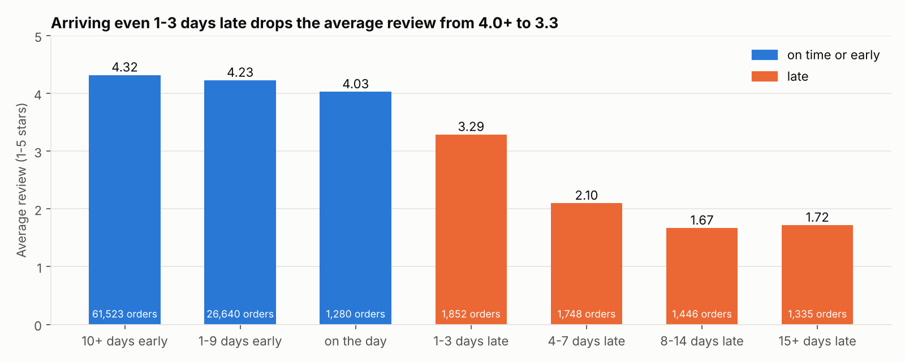
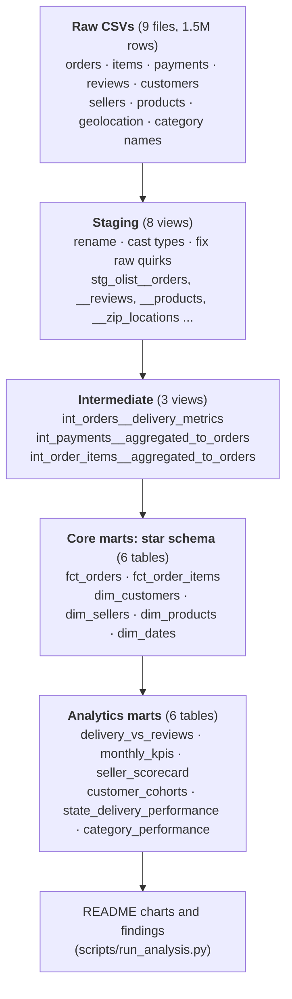
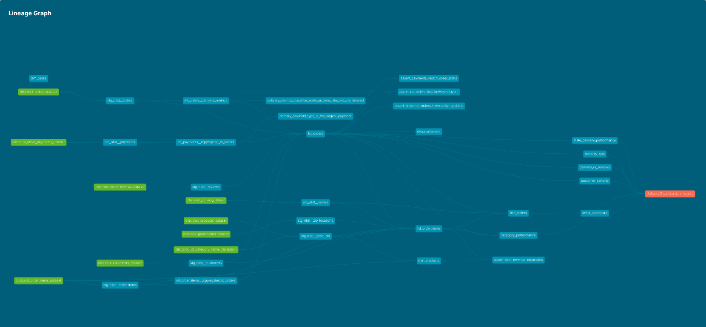
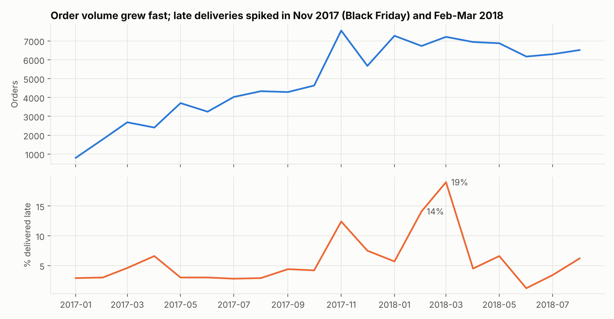
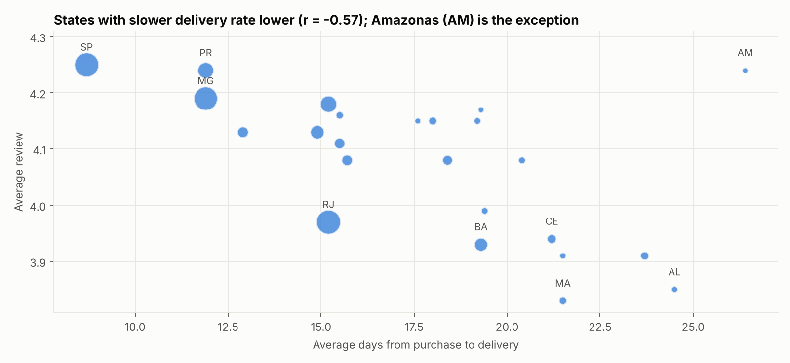

# Olist E-Commerce Analytics Engineering (dbt + DuckDB)

[](https://github.com/Mallika56/olist-ecommerce-dbt/actions/workflows/ci.yml)

An analytics-engineering project on **99,441 real orders** from Olist, Brazil's largest department-store
marketplace (Sep 2016 – Oct 2018). Raw CSVs are modeled with **dbt** into a tested **star schema**, then
used to answer one business question: **how much do late deliveries cost in customer satisfaction, and
where do they happen?**

`dbt` `SQL` `DuckDB` `Python` `Data modeling` `Star schema` `Data testing` `GitHub Actions`

---

## The answer in one chart



* **Late orders are 6.7% of deliveries but 32.5% of all 1–2 star reviews.** On-time orders average
  **4.29 stars**; late orders average **2.27**, and 53.8% of late orders get a 1-star review (vs 6.6% on time).
* **The drop happens immediately.** Arriving just 1–3 days late takes the average from 4.0+ to 3.29.
* **Olist pads its promises.** The median order arrives **12 days before** the date shown at checkout,
  which is why 92% of orders land early. The problem is the 6.8% that miss.

## Data model



| Layer | Materialized | Purpose |
|---|---|---|
| **Staging** (8 models) | views | One model per source. Rename, cast types, fix raw quirks. No joins, no business logic. |
| **Intermediate** (3) | views | Reusable logic: delivery performance vs the promised date, payments and items rolled up to one row per order. |
| **Core marts** (6) | tables | The star schema. Two facts at different grains (order, order item) and four dimensions. |
| **Analytics marts** (6) | tables | Answer-shaped tables for dashboards: satisfaction by delivery timing, monthly KPIs, seller tiers, cohorts. |

The real dbt lineage graph (from `dbt docs`):



## Raw-data problems found and handled

Every one of these would silently corrupt a naive analysis:

| Problem in the raw data | What goes wrong if ignored | How it's handled |
|---|---|---|
| `customer_id` is **new on every order**; the person is `customer_unique_id` | Every customer looks like a one-time buyer | All customer metrics use `customer_unique_id` (96,096 people, not 99,441) |
| **547 orders have more than one review** | Joining reviews to orders duplicates rows and inflates revenue | `stg_olist__reviews` keeps the latest answered review; a `unique` test guards it |
| An order with 3 units has **3 item rows** | Counting items as orders | Separate facts per grain: `fct_orders` (order) and `fct_order_items` (item) |
| Orders split across **voucher + card** payments | Picking a random payment type | `primary_payment_type` = the method that paid the largest share (unit tested) |
| **2 categories missing** from Olist's translation table | 'Unknown' categories in reports | Filled in `stg_olist__products` |
| Column names misspelled (`product_name_lenght`) | Typos spread downstream | Renamed once in staging |
| **~1M geolocation rows**, some outside Brazil | Wrong distances, huge joins | Points outside Brazil dropped, averaged to one centroid per zip prefix |
| **Credit-card instalments add interest**, so paid > order total | False "payment mismatch" alerts | Reconciliation test excludes them (227 orders); the 20 genuine mismatches (0.02%) raise a warning |
| Sparse months at the start (2016) and end (Sep–Oct 2018) | Misleading trend lines | `monthly_kpis.is_complete_month` flag |

## Testing

`dbt build` runs **23 models, 81 data tests and 2 unit tests**. All pass.

* **Generic tests:** `unique`, `not_null`, `accepted_values` and `relationships` on every key and foreign key.
* **A custom generic test**, `positive_value`, for prices, freight and payments.
* **Singular tests** that reconcile layers:
  * no orders are lost or duplicated between raw and `fct_orders`
  * total item revenue in raw equals total in `fct_order_items`
  * delivered orders have a delivery date after purchase
  * payments match order totals, within the instalment-interest rule above
* **dbt unit tests** (dbt 1.8+) on fixed inputs:
  * delivery classification (early / on the day / late / undelivered must be NULL, not "on time")
  * the primary-payment rule
* **CI:** GitHub Actions downloads the data, verifies SHA-256 checksums, runs `dbt build`, generates
  the docs site (uploaded as an artifact), and re-runs the analysis on every push.

## Results

All numbers are produced by `scripts/run_analysis.py` from the marts (`docs/results/`).

**1. Late delivery is the biggest driver of bad reviews.** See the chart above.

**2. Late deliveries spike with demand.** The late rate jumped to **12.4%** in Nov 2017 (Black Friday month)
and peaked at **19.0%** in Mar 2018, with average reviews falling to 3.91 and 3.75 in those months.



**3. Geography matters.** Items shipped to a customer in the same state arrive in **7.9 days on average,
vs 15.0** across states, and are late less often (4.4% vs 7.8%). Across states, slower delivery goes with
lower ratings (r = −0.57). Amazonas is the exception: very slow, yet well rated.



**4. Sellers.** Of the 634 sellers with 30+ orders, 126 are *top performers* (≤5% late, ≥4.3 stars) and
**89 are *at risk*** (≥15% late or <3.8 stars). Those 89 still sold R$1.08M of goods, so fixing them
protects real revenue.

**5. Almost nobody comes back.** Only **3.0%** of customers ever place a second completed order, and just
**0.48%** order again in the month after their first purchase. Growth comes from new customers.

### Recommendations

1. **Make "late" the top operational KPI**, not average delivery time. Satisfaction collapses past the promised
   date, while arriving early earns little extra.
2. **Add carrier and warehouse capacity before peaks** (Black Friday, Feb–Mar). The late rate tripled in
   those windows.
3. **Put at-risk sellers on a performance plan** using `seller_scorecard`. Where possible, route orders to
   in-state sellers, since same-state items arrive in about half the time.
4. **Invest in retention**, for example post-delivery offers to customers whose orders arrived on time. With 3%
   repeat customers, retention is the biggest untapped lever.

## Run it

```bash
pip install -r requirements.txt
python scripts/download_data.py      # 9 CSVs (~126 MB), SHA-256 verified
dbt build --profiles-dir .           # models + 81 data tests + 2 unit tests (~15 s)
python scripts/run_analysis.py       # results + charts
dbt docs generate --profiles-dir . && dbt docs serve --profiles-dir .   # docs site + lineage
```

The warehouse is a single DuckDB file (`olist.duckdb`), so no database server or cloud account is needed.
The same models would run on Snowflake or BigQuery by switching the dbt adapter. Open the file in
DuckDB, DBeaver or Python to query `core.fct_orders` etc.

## Data

[Brazilian E-Commerce Public Dataset by Olist](https://www.kaggle.com/datasets/olistbr/brazilian-ecommerce)
(Kaggle, CC BY-NC-SA 4.0): real, anonymized marketplace data. The download script fetches a public GitHub
copy pinned to one commit and verifies every file against the SHA-256 of the original Kaggle files.
`--kaggle` downloads from Kaggle directly.

## Project layout

```
models/staging/        8 source-conformed models + sources and tests (YAML)
models/intermediate/   3 business-logic models + 2 dbt unit tests
models/marts/core/     fct_orders, fct_order_items, dim_customers, dim_sellers, dim_products, dim_dates
models/marts/analytics/  6 answer-shaped tables + an exposure documenting what uses them
tests/generic/         custom positive_value test
tests/singular/        4 reconciliation tests
macros/                schema naming
scripts/               download_data.py (checksummed), run_analysis.py (results + charts)
learn/walkthrough.md   plain-language guide to every part, with interview Q&A
```

## What I'd do next

* Make `fct_orders` **incremental** (`materialized='incremental'`), so daily loads only process new orders.
* Add **snapshots** to track seller and product attributes over time (SCD Type 2).
* Analyze review **comment text** (Portuguese NLP) to separate delivery complaints from product complaints.
* Point the same models at **Snowflake** and build a Power BI or Tableau dashboard on the analytics marts.
